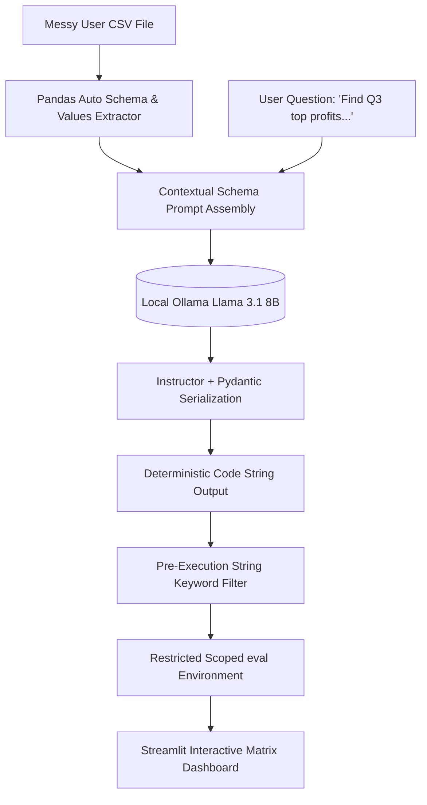

# Zero-SQL Database Assistant: Private Text-to-Pandas Ingestion Pipeline

A production-grade, local-first analytical platform designed to empower operational business groups to run unstructured data audits completely in natural English without database language skill prerequisites. The architecture solves the security and stability risks of dynamic LLM systems by combining structured Pydantic schema validation with an isolated execution sandbox.

---

## 🏗️ Architectural Overview & Security Blueprint



### Advanced Engineering Strategy Highlights

1. **Deterministic Execution Contracts:** Bypasses conversational noise (chat text) completely by wrapping the local Llama connection layer with `instructor`. The system explicitly constrains outputs into deterministic JSON parameters (`thought_process`, `pandas_code`).
2. **Dynamic Schema Bridging:** Avoids parsing breakdowns on raw corporate datasets containing chaotic column headers (e.g., `"Total Profit ($)"`, `"product_ID  "`) by mapping the column names into the system prompt context at runtime.
3. **Decoupled Namespace Sandboxing:** Eliminates host command execution risks (prompt injection payload hacks) by routing text through a restricted scope environment that blocks global primitives (`__builtins__`) and filters harmful code sequences like `.drop()` or `import os`.

---

## ⚙️ Installation & Lifecycle Guide

### 1. Engine Prerequisites
Ensure your background local **Ollama** engine server is active:
```bash
ollama run llama3.1
```

### 2. Sandbox Setup
Initialize a pristine local virtual environment and install the verified packages:
```bash
python -m venv .venv
.venv\Scripts\activate
pip install -r requirements.txt
```

### 3. Launching the App Workspace
Start the system using the native web application dashboard port:
```bash
streamlit run app.py
```

---

## 📊 Verification Metrics

## 📊 Verification Metrics

| Interaction Vector Verified | Vulnerability Handled | System Action Verdict |
| :--- | :--- | :--- |
| **Standard User Request** | Schema Header Matching | **Success** (Code compiled using messy inputs) |
| **Malicious Injection Call** | Command Intrusion (`import os`) | **Terminated** (Caught by sandbox guardrail) |
| **Destructive Data Call** | Matrix Frame Drops (`df.drop`) | **Blocked** (Flagged as non-readable query pattern) |

